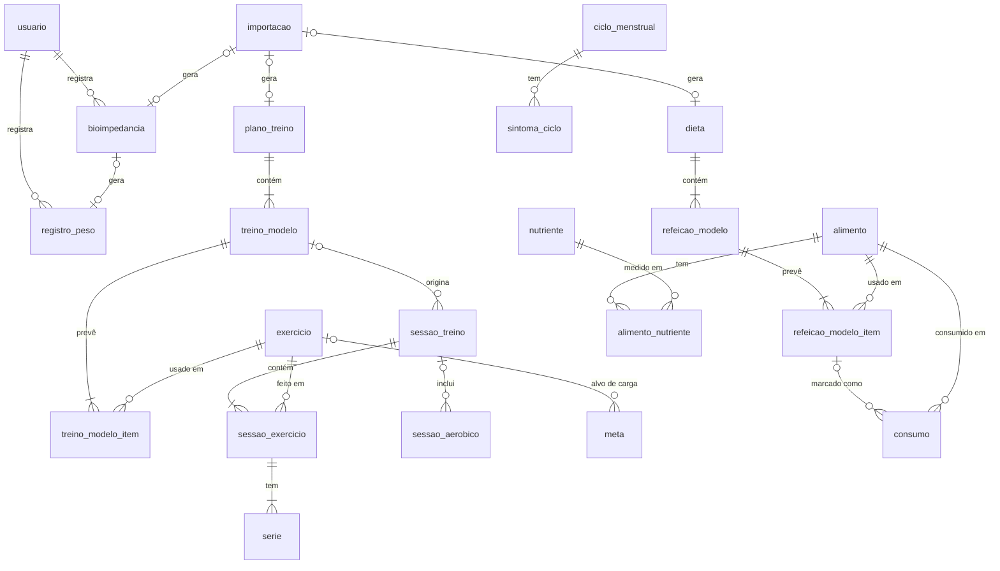

# Modelo de Dados do App de Treino e Dieta

Atualizado em 17/10/2026.

## Decisões gerais

O modelo é relacional: SQLite no aparelho durante o MVP (via expo-sqlite) e PostgreSQL na nuvem no lançamento (ex.: Supabase), com o mesmo esquema. Os IDs dos requisitos (RF, RNF, RN) referem-se ao [escopo](escopo.md).

| Decisão | Escolha | Motivo |
| --- | --- | --- |
| Chave primária | UUID gerado no aparelho, guardado como TEXT | Registros criados offline sobem para a nuvem sem conflito de ID (RNF07) |
| Usuário | Toda tabela de dados pessoais tem `usuario_id`, mesmo com um só usuário no MVP | A migração para contas não exige mudar o esquema |
| Auditoria | `criado_em`, `atualizado_em` e `excluido_em` em toda tabela | Exclusão lógica permite sincronizar exclusões com a nuvem |
| Datas | Texto ISO 8601: `AAAA-MM-DD` para datas e data-hora com fuso | SQLite não tem tipo de data nativo; o formato ISO ordena corretamente |
| Enumerações | TEXT com `CHECK` (valores listados em cada tabela) | Legível no banco e simples de migrar para ENUM do PostgreSQL |
| Unidades | No nome da coluna: `_kg`, `_cm`, `_min`, `_km`, `_kcal`, `_pct`, `_g` | Elimina dúvida sobre a unidade |
| Valores calculados | Não são armazenados (ver seção própria) | Evita dados inconsistentes |
| Autor | Planos de treino e dietas têm `autor_id` (nulo no MVP) | Prepara o uso por personal e nutricionista (ideia futura) |

Por brevidade, as colunas de auditoria e o `usuario_id` não são repetidos nas tabelas abaixo; "FK" indica chave estrangeira.

## Visão geral

Treino e dieta seguem o mesmo padrão: um lado guarda o plano (o que deveria ser feito) e o outro guarda o que foi feito de fato, ligados por chave estrangeira. Toda tabela pessoal também se liga a `usuario` (omitido no diagrama para legibilidade).



As tabelas `integracao` e `gasto_ativo_diario` ligam-se apenas a `usuario`.

## Usuário, peso e bioimpedância

O perfil guarda a data de nascimento, e não a idade, para que a idade usada na TMB e nas tabelas de classificação esteja sempre correta.

### usuario

| Campo | Tipo | Regras | Req. |
| --- | --- | --- | --- |
| id | TEXT (UUID) | PK | — |
| nome | TEXT | obrigatório | RF23 |
| data_nascimento | TEXT (data) | obrigatório | RF23 |
| sexo | TEXT | `feminino`, `masculino` | RF23 |
| altura_cm | REAL | > 0 | RF23 |
| meta_calorias_kcal | INTEGER | nulo = sem meta; usada só sem dieta ativa | RF36, RN05 |
| ciclo_ativo | INTEGER (0/1) | só pode ser 1 se sexo = feminino | RF51 |

### registro_peso

Histórico de pesagens; o peso atual é o registro mais recente.

| Campo | Tipo | Regras | Req. |
| --- | --- | --- | --- |
| id | TEXT (UUID) | PK | — |
| data | TEXT (data) | obrigatório | RF31 |
| peso_kg | REAL | > 0 | RF31 |
| origem | TEXT | `manual`, `bioimpedancia`, `integracao` | RF31, RN09 |
| bioimpedancia_id | TEXT | FK → bioimpedancia, nulo se não veio de exame | RN09 |

### bioimpedancia

| Campo | Tipo | Regras | Req. |
| --- | --- | --- | --- |
| id | TEXT (UUID) | PK | — |
| data | TEXT (data) | obrigatório | RF41 |
| peso_kg | REAL | obrigatório; também gera um registro_peso | RF47 |
| cintura_cm | REAL | opcional | RF47 |
| gordura_pct | REAL | 0–100 | RF47 |
| musculo_esqueletico_pct | REAL | 0–100 | RF47 |
| metabolismo_repouso_kcal | INTEGER | > 0; quando presente, é a TMB | RF47, RN14 |
| idade_biologica | INTEGER | opcional | RF47 |
| gordura_visceral_nivel | INTEGER | 1–30 | RF47 |
| importacao_id | TEXT | FK → importacao, nulo se manual | RF50 |

## Treino e aeróbicos

O treino separa o que foi **planejado** (plano → treino modelo → exercícios previstos) do que foi **realizado** (sessão → exercícios → séries). Assim, o histórico guarda o que a pessoa fez de fato, mesmo que difira do plano (RN02).

### exercicio

Catálogo de exercícios: cerca de 60 exercícios padrão em português, que vêm com o app, mais os criados pelo usuário. Imagens e GIFs ficam para versões futuras, usando o campo `midia_uri`. `usuario_id` nulo = exercício padrão do app, preenchido = criado pelo usuário.

| Campo | Tipo | Regras | Req. |
| --- | --- | --- | --- |
| id | TEXT (UUID) | PK | — |
| nome | TEXT | obrigatório, em português | RF04 |
| grupo_muscular | TEXT | grupo principal, ex.: `peito`, `costas`, `pernas` | RF04 |
| grupos_secundarios | TEXT (JSON) | lista; opcional | — |
| equipamento | TEXT | ex.: `barra`, `halter`, `maquina`, `peso_corporal` | — |
| instrucoes | TEXT | passo a passo; opcional | — |
| midia_uri | TEXT | imagem ou GIF de demonstração; opcional | — |
| codigo_met | TEXT | atividade no Compendium of Physical Activities | RF46 |
| fonte | TEXT | `base_aberta`, `usuario` | — |
| id_externo | TEXT | ID na base de origem; opcional | — |

### plano_treino

| Campo | Tipo | Regras | Req. |
| --- | --- | --- | --- |
| id | TEXT (UUID) | PK | — |
| nome | TEXT | obrigatório | RF04 |
| ativo | INTEGER (0/1) | no máximo um plano ativo por usuário | RF04 |
| autor_id | TEXT | nulo no MVP | ideia futura |
| importacao_id | TEXT | FK → importacao, nulo se manual | RF05–RF07 |

### treino_modelo

Cada treino do plano (ex.: A, B, C).

| Campo | Tipo | Regras | Req. |
| --- | --- | --- | --- |
| id | TEXT (UUID) | PK | — |
| plano_treino_id | TEXT | FK → plano_treino | RF04 |
| nome | TEXT | ex.: "Treino A – Peito" | RF04 |
| ordem | INTEGER | posição no plano | RF04 |

### treino_modelo_item

Exercício previsto em um treino modelo. Um aeróbico previsto também entra aqui, com as colunas de séries vazias.

| Campo | Tipo | Regras | Req. |
| --- | --- | --- | --- |
| id | TEXT (UUID) | PK | — |
| treino_modelo_id | TEXT | FK → treino_modelo | RF04 |
| exercicio_id | TEXT | FK → exercicio; nulo se for aeróbico | RF04 |
| tipo_aerobico | TEXT | preenchido só se for aeróbico | RF24 |
| ordem | INTEGER | posição no treino | RF04 |
| series_previstas | INTEGER | > 0 | RF04 |
| reps_min / reps_max | INTEGER | iguais quando a faixa é fixa (ex.: 10) | RF04 |
| carga_prevista_kg | REAL | opcional | RF04 |
| duracao_prevista_min | REAL | só para aeróbico; opcional | RF24 |
| observacao | TEXT | opcional | — |

### sessao_treino

Um treino realizado. Pode seguir um treino do plano ou ser livre, sem plano; aeróbicos fora da ficha também podem ser registrados.

| Campo | Tipo | Regras | Req. |
| --- | --- | --- | --- |
| id | TEXT (UUID) | PK | — |
| treino_modelo_id | TEXT | FK → treino_modelo; nulo = treino livre | RF08 |
| inicio / fim | TEXT (data-hora) | fim ≥ início; fim nulo enquanto não for finalizada | RF08, RF10 |
| status | TEXT | `em_andamento`, `pausada`, `concluida`, `parcial` | RF65, RF66, RN22, RN23 |
| pausada_em | TEXT (data-hora) | preenchido quando status = pausada | RF66, RN23 |
| segundos_pausada | INTEGER | soma das pausas, descontada da duração | RF66 |
| calorias_gastas_kcal | INTEGER | estimada (METs) ou importada | RF46, RN11 |
| origem_gasto | TEXT | `estimativa`, `integracao` | RN11 |

### sessao_exercicio

| Campo | Tipo | Regras | Req. |
| --- | --- | --- | --- |
| id | TEXT (UUID) | PK | — |
| sessao_treino_id | TEXT | FK → sessao_treino | RF09 |
| exercicio_id | TEXT | FK → exercicio | RF09 |
| treino_modelo_item_id | TEXT | FK → treino_modelo_item; liga ao previsto (séries e repetições); nulo em treino livre | RF09, RN02 |
| ordem | INTEGER | posição na sessão | RF09 |

### serie

Cada série feita; é a tabela consultada para "última carga" e metas de carga.

| Campo | Tipo | Regras | Req. |
| --- | --- | --- | --- |
| id | TEXT (UUID) | PK | — |
| sessao_exercicio_id | TEXT | FK → sessao_exercicio | RF09 |
| numero | INTEGER | 1, 2, 3… | RF09 |
| carga_kg | REAL | ≥ 0 (0 = peso corporal) | RF09 |
| repeticoes | INTEGER | > 0 | RF09 |

### sessao_aerobico

Pode estar ligada a uma sessão de treino ou ser isolada.

| Campo | Tipo | Regras | Req. |
| --- | --- | --- | --- |
| id | TEXT (UUID) | PK | — |
| sessao_treino_id | TEXT | FK → sessao_treino; nulo = isolada | RF24 |
| tipo | TEXT | `esteira`, `bicicleta`, `eliptico`, `corrida_rua`, `caminhada`, `outro` | RF25 |
| inicio | TEXT (data-hora) | obrigatório; usado para detectar duplicidade | RF25, RN13 |
| duracao_min | REAL | > 0 | RF25 |
| distancia_km | REAL | opcional | RF25 |
| intensidade_escala | TEXT | `leve`, `moderada`, `intensa`; opcional | RF25 |
| intensidade_pse | INTEGER | 1–10; opcional | RF25 |
| fc_media_bpm | INTEGER | opcional | RF25 |
| inclinacao_pct | REAL | esteira; opcional | RF26 |
| nivel_carga | REAL | bicicleta; opcional | RF26 |
| calorias_gastas_kcal | INTEGER | estimada ou importada | RF46, RN11 |
| origem | TEXT | `manual`, `apple_saude`, `health_connect` | RF44, RN13 |
| id_externo | TEXT | ID no Apple Saúde/Health Connect; único por origem | RN13 |
| editado_pelo_usuario | INTEGER (0/1) | 1 = usuário sobrescreveu os dados do relógio | RN13 |

## Metas

Os quatro tipos de meta ficam numa única tabela, com as colunas específicas de cada tipo preenchidas conforme o `tipo` (validado por `CHECK`). O progresso não é armazenado: é calculado a partir de séries, sessões, pesagens e registros alimentares.

### meta

| Campo | Tipo | Regras | Req. |
| --- | --- | --- | --- |
| id | TEXT (UUID) | PK | — |
| tipo | TEXT | `carga`, `frequencia`, `peso`, `dieta` | RF28–RF32 |
| exercicio_id | TEXT | FK → exercicio; obrigatório só se tipo = carga | RF28 |
| carga_alvo_kg | REAL | obrigatório só se tipo = carga | RF28 |
| treinos_semana | INTEGER | tipo = frequencia; ao menos um dos dois preenchido | RF29, RN07 |
| aerobicos_semana | INTEGER | tipo = frequencia | RF29, RN07 |
| peso_alvo_kg | REAL | obrigatório só se tipo = peso | RF30 |
| peso_inicial_kg | REAL | peso atual na criação da meta; base do progresso | RF30 |
| dias_dieta_alvo | INTEGER | obrigatório só se tipo = dieta | RF32, RN10 |
| data_inicio | TEXT (data) | obrigatório | RF12 |
| prazo | TEXT (data) | opcional | RF12 |
| status | TEXT | `ativa`, `atingida`, `cancelada` | RF12, RF33 |
| atingida_em | TEXT (data) | preenchido quando status = atingida | RF13 |

## Dieta e alimentos

Os nutrientes ficam numa tabela própria (`alimento_nutriente`), e não em colunas fixas do alimento. Assim, os mais de 30 componentes da TBCA e os poucos da Open Food Facts cabem no mesmo modelo, e um nutriente novo não exige mudar o esquema. Todos os valores são por 100 g; o consumo é calculado pela quantidade em gramas.

### nutriente

Catálogo fixo, carregado com o app.

| Campo | Tipo | Regras | Req. |
| --- | --- | --- | --- |
| id | TEXT | PK, código legível (ex.: `proteina`, `ferro`) | RF34 |
| nome | TEXT | ex.: "Proteína" | RF34 |
| unidade | TEXT | `kcal`, `g`, `mg`, `mcg` | RF34 |
| categoria | TEXT | `energia`, `macro`, `micro` | RF34 |
| recomendado_dia | REAL | valor diário de referência para adultos (ANVISA, IN 75/2020); nulo para energia e macros | RF34 |
| ordem | INTEGER | ordem de exibição | — |

### alimento

`usuario_id` nulo = alimento da base do app (compartilhado); preenchido = adicionado pelo usuário. No MVP, a base vem da TACO 4ª edição (597 alimentos, fonte `taco`, id `taco-<número na TACO>`); alguns itens sem equivalente na TACO (whey, peito de peru, granola…) ficam como `base_app`. A TBCA entra quando for autorizada.

| Campo | Tipo | Regras | Req. |
| --- | --- | --- | --- |
| id | TEXT (UUID) | PK | — |
| nome | TEXT | obrigatório | RF14 |
| marca | TEXT | opcional | RF38 |
| fonte | TEXT | `tbca`, `taco`, `base_app`, `open_food_facts`, `rotulo`, `manual` | RNF06, RF38–RF40 |
| categoria | TEXT | grupo da tabela de origem (ex.: "Frutas e derivados"); opcional | RNF06 |
| codigo_tbca | TEXT | único quando fonte = tbca | RNF06 |
| codigo_barras | TEXT | único quando presente | RF38 |
| porcao_padrao_g | REAL | opcional | RF14 |
| medida_caseira | TEXT | ex.: "1 colher de sopa"; opcional | RF14 |

### alimento_nutriente

| Campo | Tipo | Regras | Req. |
| --- | --- | --- | --- |
| alimento_id | TEXT | PK composta; FK → alimento | RF34 |
| nutriente_id | TEXT | PK composta; FK → nutriente | RF34 |
| valor_por_100g | REAL | ≥ 0, na unidade do nutriente | RF34 |

### dieta

| Campo | Tipo | Regras | Req. |
| --- | --- | --- | --- |
| id | TEXT (UUID) | PK | — |
| nome | TEXT | obrigatório | RF14 |
| ativa | INTEGER (0/1) | no máximo uma dieta ativa por usuário | RF14, RN05 |
| autor_id | TEXT | nulo no MVP | ideia futura |
| importacao_id | TEXT | FK → importacao, nulo se manual | RF15–RF17 |

### refeicao_modelo

| Campo | Tipo | Regras | Req. |
| --- | --- | --- | --- |
| id | TEXT (UUID) | PK | — |
| dieta_id | TEXT | FK → dieta | RF14 |
| nome | TEXT | ex.: "Café da manhã" | RF14 |
| horario | TEXT (HH:MM) | opcional; base dos lembretes futuros | RF57 |
| ordem | INTEGER | posição no dia | RF14 |

### refeicao_modelo_item

| Campo | Tipo | Regras | Req. |
| --- | --- | --- | --- |
| id | TEXT (UUID) | PK | — |
| refeicao_modelo_id | TEXT | FK → refeicao_modelo | RF14 |
| alimento_id | TEXT | FK → alimento | RF14 |
| quantidade_g | REAL | > 0 | RF14 |

### consumo

Cada alimento consumido. Um item da dieta marcado como consumido gera uma linha com `refeicao_modelo_item_id`; um alimento avulso, uma linha sem ele.

| Campo | Tipo | Regras | Req. |
| --- | --- | --- | --- |
| id | TEXT (UUID) | PK | — |
| data | TEXT (data) | obrigatório | RF18–RF20 |
| horario | TEXT (HH:MM) | opcional | RF18 |
| refeicao_modelo_item_id | TEXT | FK → refeicao_modelo_item; nulo = avulso | RF18, RF19 |
| refeicao_nome | TEXT | ex.: "Almoço"; agrupa avulsos e registros sem dieta | RF19, RF20 |
| alimento_id | TEXT | FK → alimento | RF18–RF20 |
| quantidade_g | REAL | > 0; pode diferir da quantidade prevista | RF18 |

## Ciclo menstrual

As fases e a previsão da próxima menstruação são calculadas a partir dos ciclos registrados (RF53). Os dados são visíveis apenas para a usuária (RN20).

### ciclo_menstrual

| Campo | Tipo | Regras | Req. |
| --- | --- | --- | --- |
| id | TEXT (UUID) | PK | — |
| data_inicio | TEXT (data) | obrigatório | RF52 |
| data_fim | TEXT (data) | ≥ data_inicio; nulo enquanto em curso | RF52 |
| intensidade_fluxo | TEXT | `leve`, `moderado`, `intenso`; opcional | RF52 |
| origem | TEXT | `manual`, `apple_saude`, `health_connect` | RF55 |
| id_externo | TEXT | ID na integração; opcional | RF55 |

### sintoma_ciclo

| Campo | Tipo | Regras | Req. |
| --- | --- | --- | --- |
| id | TEXT (UUID) | PK | — |
| ciclo_menstrual_id | TEXT | FK → ciclo_menstrual | RF52 |
| data | TEXT (data) | dentro do ciclo | RF52 |
| sintoma | TEXT | `colica`, `fadiga`, `dor_cabeca`, `inchaco`, `outro` | RF52 |

## Importações e integrações

Toda importação por foto ou PDF fica registrada até o usuário revisar o resultado; o plano, dieta ou exame só é gravado após a confirmação (RN01). O arquivo fica no armazenamento do aparelho, protegido como dado de saúde (RNF04).

### importacao

| Campo | Tipo | Regras | Req. |
| --- | --- | --- | --- |
| id | TEXT (UUID) | PK | — |
| alvo | TEXT | `plano_treino`, `dieta`, `bioimpedancia`, `alimento_rotulo` | RF05–RF07, RF15–RF17, RF39, RF50 |
| formato | TEXT | `foto`, `pdf` | RF05, RF06 |
| arquivo_uri | TEXT | caminho local do arquivo | RNF04 |
| status | TEXT | `processando`, `aguardando_revisao`, `confirmada`, `descartada`, `erro` | RF07, RN01 |
| resultado_json | TEXT (JSON) | dados reconhecidos, antes da revisão | RF07 |

### integracao

| Campo | Tipo | Regras | Req. |
| --- | --- | --- | --- |
| id | TEXT (UUID) | PK | — |
| provedor | TEXT | `apple_saude`, `health_connect`; único por usuário | RF44 |
| ativa | INTEGER (0/1) | — | RF44, RF46 |
| ultima_sincronizacao | TEXT (data-hora) | início da próxima leitura incremental | RF44 |

### gasto_ativo_diario

Energia ativa do dia medida pelo relógio (passos, caminhadas, treinos), importada do Apple Saúde ou do Health Connect. Existe só para quem usa relógio.

| Campo | Tipo | Regras | Req. |
| --- | --- | --- | --- |
| id | TEXT (UUID) | PK | — |
| data | TEXT (data) | único por usuário e origem | RF44, RF45 |
| energia_ativa_kcal | INTEGER | ≥ 0; não inclui o metabolismo basal | RF45 |
| origem | TEXT | `apple_saude`, `health_connect` | RF44 |
| sincronizado_em | TEXT (data-hora) | última atualização do valor | RF44 |

### preferencia

Preferências locais do aparelho, em chave e valor (tema, consentimento da LGPD e do ciclo). Não tem `usuario_id` nem auditoria e não sobe para a nuvem.

| Campo | Tipo | Regras | Req. |
| --- | --- | --- | --- |
| chave | TEXT | PK; ex.: `tema`, `consentimento`, `consentimento_ciclo` | RNF03, RNF10 |
| valor | TEXT | `claro`/`escuro` (nulo = automático); data-hora do consentimento; `0`/`1` | RNF03, RNF10 |

## Dados calculados, não armazenados

Estes valores são calculados na hora, a partir das tabelas acima. Se algum ficar lento com o histórico grande, pode ganhar uma tabela de cache depois, sem mudar as tabelas de origem.

| Valor | Como é calculado | Req. |
| --- | --- | --- |
| Idade | data atual − `usuario.data_nascimento` | RF23 |
| Peso atual | `registro_peso` mais recente | RF31 |
| IMC | peso atual ÷ (altura_cm ÷ 100)² | RF48, RN15 |
| Classificações da bioimpedância | tabelas de referência do escopo, por sexo e idade; sem classificação fora das faixas | RF49, RN16–RN19 |
| TMB | `metabolismo_repouso_kcal` da bioimpedância mais recente; senão, Mifflin-St Jeor | RN08, RN14 |
| Meta calórica do dia | soma das calorias dos itens da dieta ativa; senão `usuario.meta_calorias_kcal`; senão, sem meta | RF35, RF36, RN05 |
| Calorias e nutrientes consumidos | Σ (`consumo.quantidade_g` ÷ 100 × `alimento_nutriente.valor_por_100g`) no dia | RF21, RF34, RN03 |
| Gasto do dia | com relógio: TMB + energia ativa do dia (`gasto_ativo_diario`), que já inclui os treinos, então as sessões não são somadas de novo; sem relógio: TMB + calorias das sessões de treino e aeróbico do dia | RN06 |
| Balanço calórico | consumido − gasto | RF21, RN06 |
| Dia na dieta | com dieta ativa: consumido dentro de ±7% da meta calórica | RN10 |
| Última carga do exercício | `serie` da sessão mais recente com aquele exercício | RF11 |
| Progresso das metas | carga: maior `serie.carga_kg` desde o início; frequência: sessões na semana; peso: peso atual; dieta: dias seguidos na dieta | RF13 |
| Fase do ciclo e próxima menstruação | média da duração dos últimos ciclos registrados | RF53, RF54, RF64 |

Sem integração, o gasto de cada sessão é estimado pelo Compendium of Physical Activities: kcal = MET da atividade (`exercicio.codigo_met` ou o tipo do aeróbico) × peso (kg) × duração (h).

A fórmula de Mifflin-St Jeor, com peso em kg, altura em cm e idade em anos (s = +5 para o sexo masculino, −161 para o feminino):

```math
\text{TMB} = 10 \cdot \text{peso} + 6{,}25 \cdot \text{altura} - 5 \cdot \text{idade} + s
```
